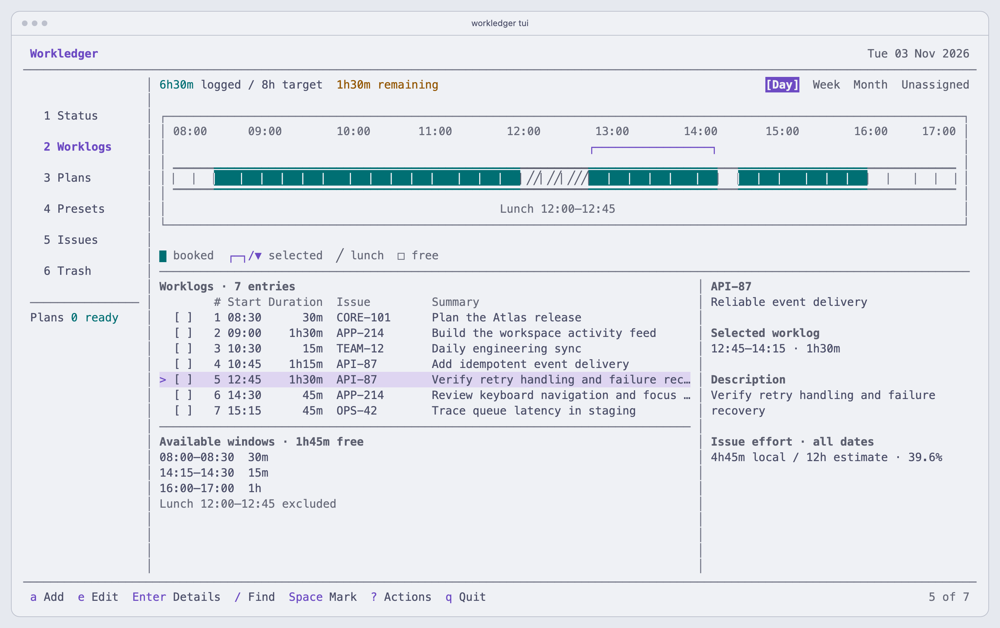

<div align="center">
  <picture>
    <source media="(prefers-color-scheme: dark)" srcset="docs/assets/branding/ledger-w-refined/workledger-w-dark.svg">
    
  </picture>
  <h1>Workledger</h1>
  <p>An agent-friendly CLI for local worklogs,<br>daily planning, and reviewed sync with Jira and Clockify.</p>
  <p>Structured JSON · Dry runs · Local storage · Optional TUI</p>
  <p>
    <a href="#quick-start">Quick start</a> ·
    <a href="docs/agents.md">Agent workflows</a> ·
    <a href="docs/README.md">Documentation</a> ·
    <a href="docs/configuration.md">Connect a tracker</a> ·
    <a href="docs/development.md">Development</a>
  </p>
  <p>
    <a href="https://github.com/solitus0/workledger/actions/workflows/ci.yml"></a>
    <a href="LICENSE"></a>
  </p>
</div>

<picture>
  <source media="(prefers-color-scheme: dark)" srcset="docs/assets/screenshots/worklogs-wide-dark.png">
  
</picture>

<p align="center"><sub>The optional TUI’s real Worklogs renderer, with fictional Atlas project data. Full size: <a href="docs/assets/screenshots/worklogs-wide-dark.png">Dark</a> · <a href="docs/assets/screenshots/worklogs-wide-light.png">Light</a>. <a href="docs/media.md">Capture details and other layouts</a>.</sub></p>

## Quick start

Install with Homebrew:

```sh
brew install solitus0/tap/workledger
```

[Other installation options](docs/installation.md).

Initialize your local ledger:

```sh
workledger init
```

Before your first entry, open `~/.config/workledger/config.yaml` and set `local_timezone` to your IANA timezone. Review the [workday and lunch settings](docs/configuration.md#set-your-workday); the starter configuration uses `Europe/Vilnius` and an 08:00–17:00 workday.

Then check readiness, log an activity, and inspect today's entries:

```sh
workledger status
workledger worklogs add --fit --today --duration 45m --description "Review the activity feed"
workledger worklogs list --today
```

`--fit` puts the activity into one free slot in your configured workday. Your new 45-minute unassigned entry should appear in the list and contribute to the logged-time total.

No remote account is required. Issue keys are optional, so you can capture work now and assign an issue later. Configuration and canonical worklogs stay on your machine in YAML and SQLite.

See [other installation options and shell completion](docs/installation.md), or [connect Jira and Clockify](docs/configuration.md) when you are ready to reconcile remote records.

## Use it from an agent

After working with an agent, invoke the [session-worklog-creator skill](docs/agents.md#log-a-coding-session) in that same chat:

```text
$session-worklog-creator 1h
```

**You choose the duration; the agent handles the rest.** Duration is the only required input. The agent writes a description from the work performed in the session and infers an issue key when the context clearly identifies one; otherwise it saves the work unassigned. Workledger places the time into available slots in your configured workday, today by default, around existing worklogs and lunch.

The skill previews the entry and saves it locally after a successful dry run. It never derives logged duration from session length or issue estimates. See [Agent workflows](docs/agents.md) for skill installation and placement details.

Agents can also use the CLI directly to read planning context as JSON and preview an entry before writing:

```sh
workledger worklogs context --today --output json
workledger worklogs add --fit --today --duration 30m --description "Review retry behavior" --dry --output json
```

JSON output stays on stdout; diagnostics and progress use stderr. Batch payloads accept files or stdin, and exit codes distinguish validation failures, partial results, and other outcomes. [Agent workflows](docs/agents.md) covers direct CLI use and optional skills for onboarding and logging coding sessions. The [CLI reference](docs/cli.md) owns payloads, output, and exit codes.

## Work from a local ledger

- **Agent-friendly commands.** Inspect structured context, preview writes with dry runs, and apply JSON batches. Saved reconciliation plans separate inspection from remote changes.
- **One local ledger.** Inspect your work, corrections, and totals independently of any remote tracker. Local deletion moves entries to recoverable trash.
- **Plan around the work already there.** Inspect gaps and quota, then place work into free slots with `--fit` or `--fill`.
- **Keep issues in context.** Group issues into local epics, inspect worklog history, and compare logged effort with optional estimates. Refresh Jira titles and estimates when needed.
- **Review before changing a tracker.** Pull or push through saved reconciliation plans. Inspect the exact scope, apply it explicitly, and handle partial failures with targeted retries.
- **Optional interactive review.** Open the TUI when a timeline or visual inspector helps. It uses the same local ledger and services as the CLI.

## Optional TUI

For an interactive workspace, run:

```sh
workledger tui
```

Use a terminal of at least **100 columns × 28 rows**. Worklogs opens on today’s entries, with a timeline, available windows, and details for the selected entry. Use `↑`/`↓` to browse, `a` to add, `?` for contextual actions, and `q` to quit. The CLI and agent workflows work independently of this view.

## Sync deliberately

The workflow is **reconcile → review → apply**. Creating a plan saves the proposed changes; applying it performs them.

**Before the first push for a date window, pull, review, and apply that complete window from every intended remote source.** A push can classify remote-only entries as cleanup and delete them. Repeat the pull when expanding into a new window or resolving a failed source.

The [synchronization guide](docs/synchronization.md) walks through the initial import, review, push, and recovery paths.

## Find your next workflow

| I want to… | Start here |
| --- | --- |
| Use Workledger from an agent or log a coding session | [Agent workflows](docs/agents.md) |
| Install, update, or enable completion | [Installation](docs/installation.md) |
| Configure storage, work hours, Jira, or Clockify | [Configuration](docs/configuration.md) |
| Import, review, push, or recover tracker changes | [Synchronization](docs/synchronization.md) |
| Add, move, group, or recover work | [Daily workflows](docs/usage.md) |
| Use the optional TUI | [Keybindings](docs/keybindings.md) |
| Use dates, JSON output, or exit codes | [CLI reference](docs/cli.md) |
| Diagnose a setup or runtime problem | [Troubleshooting](docs/troubleshooting.md) |

## Development

Workledger is maintained by a single author. The [development guide](docs/development.md) covers the code layout, checks, and maintenance workflow. The canonical behavior contracts live in [functional requirements](specs/functional.md) and [non-functional requirements](specs/non-functional.md).

[MIT licensed](LICENSE). [Releases](https://github.com/solitus0/workledger/releases).
